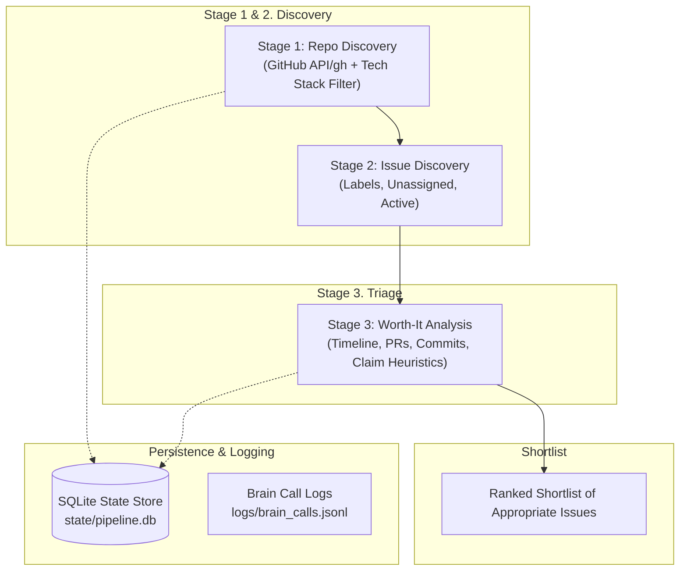

# OSS-Contributor-Agent (`vscout`)

> A local, CLI-driven autonomous agent that **finds and evaluates** appropriate open-source issues on GitHub — powered entirely by your local **OpenCode CLI**.

The agent discovers repositories matching your tech stack, finds unassigned candidate issues, runs worth-it triage, and audits contribution policies. It then presents a shortlist of issues that are appropriate to contribute to. It does **not** fork, implement, submit, or monitor pull requests — that remains in your hands.

---

## ⚡ Quick CLI Commands

Get started immediately with the command-line shortcuts:

```powershell
# 1. Run the full discovery pipeline (Stage 1 to Stage 3) and present appropriate issues
python agent.py run

# 2. Discover matching repositories and unassigned candidate issues (Stages 1-2)
python agent.py discover

# 3. Evaluate whether a specific issue is appropriate to contribute to (Stages 3-4)
python agent.py analyze https://github.com/owner/repo/issues/123
```

# Global Flags:
```powershell
python agent.py --help             # Show usage help
python agent.py --config custom.yaml  # Specify alternative config file
```

---

## 📋 Prerequisites

Before running the agent, make sure your local environment meets the following requirements:

### 1. Python 3.10+
- Python 3.10, 3.11, 3.12, 3.13, or 3.14 (tested with Python 3.14).
- Verify in your terminal:
  ```powershell
  python --version
  ```

### 2. Local OpenCode CLI
The agent uses your locally installed `opencode` CLI as its reasoning engine. No cloud API keys or external LLM SDKs are required.
- Verify that `opencode` is installed:
  ```powershell
  opencode --version
  opencode run --help
  ```
- **Verified flags utilized by this agent**:
  - `--format json`: Formats model output as JSON.
  - `--model <provider/model#variant>`: Sets a specific model variant (optional, configured in `config.yaml`).
  - `--server <url>`: Connects to a persistent background server if using `opencode serve`.
  - `--auto`: Auto-approves permissions for automated non-interactive execution.
- **Windows npm / pnpm Auto-Resolution**: The agent automatically resolves `opencode.cmd` located in `%APPDATA%\npm`, `%LOCALAPPDATA%\pnpm`, or your system `PATH`. You can also configure an explicit binary path using `opencode.opencode_path` in `config.yaml`.
- **Optional (Zero Cold Starts)**: Run `opencode serve --port 4096` in a background terminal, and set `backend: "server"` with `server_url: "http://localhost:4096"` in `config.yaml`.

### 3. Git
- Git must be installed.
- Verify:
  ```powershell
  git --version
  ```

### 4. GitHub Access
The agent supports two authentication methods (preferring `gh` CLI):
- **Option A: GitHub CLI (`gh`) [Recommended]**
  - Verify with:
    ```powershell
    gh auth status
    ```
- **Option B: GitHub Personal Access Token**
  - Generate a classic or fine-grained token with `repo` permissions.
  - Place it in your local `.env` file as `GITHUB_TOKEN=ghp_...`.

---

## 📖 How to Use

Follow this step-by-step workflow to find and evaluate appropriate open-source issues.

### Step 1: Clone and Install Dependencies
```powershell
cd "C:\Users\Burhan Vora\Desktop\Projects\vscout"
python -m pip install -r requirements.txt
```

### Step 2: Configure Environment and Settings
1. Create your local `.env` file from the example:
   ```powershell
   cp .env.example .env
   ```
   Add your GitHub token (if not using `gh` CLI):
   ```env
   GITHUB_TOKEN=ghp_your_github_token_here
   ```

2. Review and edit `config.yaml`:
   ```yaml
   tech_stack:
     - python
     - fastapi
     - typescript
     - react

   experience_level: "intermediate"
   preferred_labels:
     - "good first issue"
     - "help wanted"
     - "bug"

   min_repo_stars: 50
   max_repo_stars: 25000
   worth_score_threshold: 65

   github:
     username: "your_github_username"
   ```

### Step 3: Run the Discovery Pipeline (`python agent.py run`)
Run the end-to-end discovery pipeline through Stages 1 to 3:
```powershell
python agent.py run
```
The agent will:
1. Search GitHub for active repositories matching your `tech_stack` and activity filters.
2. Evaluate repo health and fit with OpenCode.
3. Fetch candidate open issues with preferred labels (skipping assigned issues).
4. Run deep worth-it analysis: gathering timeline events, linked PRs, commits, and claim status.
5. Present a ranked shortlist of appropriate issues.

### Step 4: Evaluate a Specific Issue (`python agent.py analyze`)
To evaluate a single issue in depth:
```powershell
python agent.py analyze https://github.com/owner/repo/issues/123
```
The agent prints a verdict (APPROPRIATE / NOT APPROPRIATE) along with worth score, issue status, and reasoning.

---

## 🏛️ Architecture Overview

All reasoning (repo ranking and issue triage) is handled by your local `opencode` CLI.



---

## 🛡️ Safety Rules & Guardrails

- **Discovery only**: The agent never forks, clones, pushes, or opens Pull Requests. It only reads public GitHub data and evaluates issues.
- **No duplicate effort**: Skips issues that are assigned, locked, or already have linked PRs.

---

## 🗂️ Project Layout

```text
vscout/
├── .env.example                 # Template for GitHub token and server config
├── config.example.yaml          # Sample configuration template
├── pyproject.toml               # Package specifications
├── requirements.txt             # Python dependencies
├── agent.py                     # Root CLI entrypoint
├── prompts/                     # Tunable prompt templates
│   ├── repo_ranker.txt          # Repo health and fit evaluation
│   └── issue_triage.txt         # Worth-it analysis schema
├── state/                       # SQLite resumable pipeline database (state/pipeline.db)
├── logs/                        # OpenCode call logs (logs/brain_calls.jsonl)
├── oss_agent/
│   ├── cli.py                   # Command-line entrypoint & routing
│   ├── config.py                # Pydantic configuration & safe template renderer
│   ├── brain.py                 # LLMBrain calling local opencode CLI with 3x retry loop
│   ├── github.py                # Dual gh CLI & REST/GraphQL API client
│   ├── state.py                 # SQLite persistent state store
│   └── stages/
│       ├── stage1_repo_discovery.py
│       ├── stage2_issue_discovery.py
│       └── stage3_worth_it.py
└── tests/
    ├── test_brain.py            # Mocked OpenCode subprocess, validation, 3x retry
    └── test_issue_status.py     # Claim detection, linked PRs, worth-score drops
```

---

## 🧪 Running Tests

Execute the unit test suite using `pytest`:

```powershell
python -m pytest -v
```

Tests validate OpenCode subprocess execution and JSON parsing, and issue triage heuristics.
